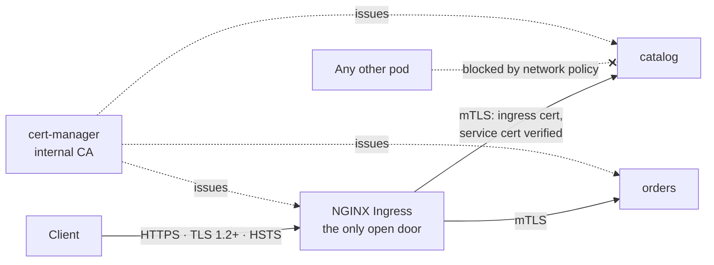

# Encrypted NGINX ingress on OpenShift

Internal microservices behind **one encrypted gate**, built the OpenShift way:
TLS from the client to NGINX, **re-encrypted with mutual TLS** from NGINX to every service, certificates issued and renewed by **cert-manager**, and **network policies** so nothing but the gate can reach the services.
Every push builds it in a fresh cluster and proves each of those claims.

[Live pipeline →](https://danielkojomegbenu.com/projects/openshift-nginx-ingress)

## The architecture



| Layer | What it does |
|---|---|
| **Gate** | F5 NGINX Ingress Controller, the only thing with ports open (80 redirects to 443). A `VirtualServer` ends TLS for `shop.local` with only TLS 1.2 and 1.3, HSTS, and no version banner |
| **Re-encryption** | An `EgressMTLS` policy on each route makes NGINX connect to the service over TLS, **present its own client certificate**, and verify the service's certificate |
| **Services** | catalog and orders run NGINX on 8443 with TLS only, and **reject anyone without a certificate from the internal CA**. They're ClusterIP only, and run under the restricted pod security level |
| **Certificates** | cert-manager runs a private CA and issues four certificates (the gate, each service, the ingress's client identity), renewing them automatically |
| **Inner wall** | A default-deny `NetworkPolicy`, plus one rule: only the ingress namespace, only on port 8443 |

## What every run proves

| Check | How | Fails when |
|---|---|---|
| Certificates issued | All four are Ready and verify against the internal CA | Any certificate is missing or untrusted |
| HTTPS through the gate | `curl --cacert ca.crt` to `/catalog` and `/orders`, the chain verified. The service replies that its caller was `CN=nginx-ingress` | HTTPS fails, HTTP isn't redirected, or there's no HSTS |
| End-to-end encryption | From inside the cluster, connecting to a service **without** the ingress's certificate gets refused, and so does plain HTTP. Through the gate, the service sees TLS 1.3 | A service accepts plain or unauthenticated traffic |
| Attack surface | A pod in another namespace can't reach the services, every service is ClusterIP, and only ports 80 and 443 are published | Anything is reachable outside the gate |

## Running it on OpenShift

The same design maps directly onto OpenShift:
- The namespace's `restricted` pod security matches OpenShift's restricted SCC, and the services already run as non-root with a read-only filesystem.
- Instead of the `VirtualServer`, use a **Route** with `termination: reencrypt`. There's an example in `openshift/route-reencrypt.yaml`.
- cert-manager and network policies work unchanged.

## See the attack surface check fail

Open the pull request **demo/debug-nodeport**. It adds a "temporary" NodePort Service to reach catalog directly while debugging.
Everything still works, but the **Attack surface check** fails: a service is now exposed outside the gate.

## Run it on your machine

```bash
kind create cluster --name gate --config kind.yaml
# then follow the steps in .github/workflows/gate.yml, and:
curl --cacert ca.crt --resolve shop.local:8443:127.0.0.1 https://shop.local:8443/catalog
```

## What's in the repo

| Path | What it is |
|---|---|
| `kind.yaml`, `ingress-values.yaml` | The cluster and the NGINX Ingress Controller settings |
| `k8s/` | The internal CA, namespace, certificates, services, gate (VirtualServer + EgressMTLS) and network policies |
| `openshift/route-reencrypt.yaml` | The OpenShift Route equivalent |
| `scripts/checks.sh` | The four proofs |
| `.github/workflows/gate.yml` | The pipeline |

## Cost

Free. Everything runs on the GitHub runner, and GitHub Actions is free for public repos.
